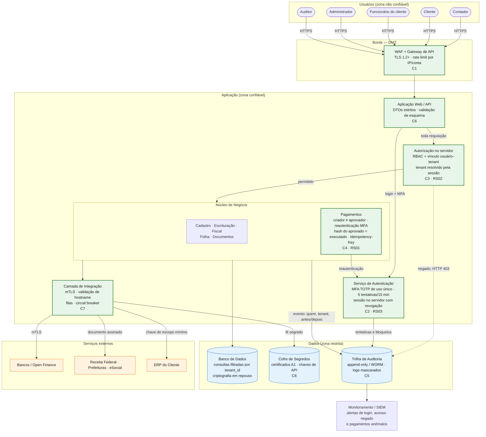

## 3.3 - Diagrama da arquitetura segura

O diagrama abaixo evolui a [arquitetura de alto nível da Etapa 1](../etapa1/04-visao-geral-arquitetura-fluxo.md#41-arquitetura-de-alto-nível)
e posiciona os controles necessários para atender aos requisitos da
[seção 3.1](3.1-requisitos-de-seguranca.md) e evitar as vulnerabilidades da
[seção 3.2](3.2-mapeamento-de-vulnerabilidades.md). Os componentes estão
organizados em zonas de confiança: toda requisição de um usuário atravessa a
borda, é autenticada, tem a autorização verificada no servidor e só então chega
ao núcleo de negócio. Os dados sensíveis, os segredos e a trilha de auditoria
ficam em uma zona restrita, acessada apenas pelos serviços internos.

O arquivo-fonte está em
[`diagramas/etapa-3/arquitetura-segura.mmd`](../../diagramas/etapa-3/arquitetura-segura.mmd)
e a imagem gerada em
[`diagramas/etapa-3/arquitetura-segura.png`](../../diagramas/etapa-3/arquitetura-segura.png).

> **Legenda:** verde — componente que aplica um controle de segurança; azul —
> armazenamento de dados sensíveis; laranja — serviço externo. A seta tracejada
> representa o registro de uma requisição negada.

### Posição dos principais controles

| ID | Controle | Componente | Requisito / vulnerabilidade | Riscos tratados |
| --- | --- | --- | --- | --- |
| C1 | TLS obrigatório, WAF e limitação de requisições por IP e por conta | WAF + Gateway de API | RS03 / VULN-03 | R01, R17, R23, R24 |
| C2 | MFA TOTP de uso único, limite de 5 tentativas em 15 minutos, sessão armazenada no servidor e revogável | Serviço de Autenticação | RS03 / VULN-03 | R01, R02, R04 |
| C3 | Verificação de perfil (RBAC) e de vínculo ativo entre usuário e tenant em toda requisição; o tenant é obtido da sessão, nunca do cliente | Autorização no servidor | RS02 / VULN-02 | R08, R18, R20 |
| C4 | Segregação de funções (criador ≠ aprovador), reautenticação acima da alçada, hash dos dados aprovados comparado aos executados e chave de idempotência | Módulo de Pagamentos | RS01 / VULN-01 | R09, R13, R26 |
| C5 | Trilha de auditoria append-only (WORM) com usuário, tenant, IP, horário e estado antes/depois; campos sensíveis mascarados | Trilha de Auditoria | RS01, RS02, RS03 | R14, R15, R16, R21 |
| C6 | DTOs estritos e validação de esquema para impedir mass assignment e dados malformados | Aplicação Web / API | RS02 | R07, R08 |
| C7 | mTLS e validação de hostname nas integrações; filas, timeouts e circuit breaker para serviços governamentais | Camada de Integração | — | R05, R25 |
| C8 | Certificados digitais e chaves de API guardados em cofre de segredos, com acesso restrito e rotação | Cofre de Segredos | — | R06 |

### Fluxo de uma operação sensível

O pagamento (R13, risco de maior prioridade) ilustra como os controles se
encadeiam:

1. O usuário acessa o sistema por HTTPS; o gateway aplica TLS e limitação de
   requisições (C1).
2. O serviço de autenticação valida senha e MFA e cria uma sessão no servidor
   (C2).
3. A cada requisição, a autorização confirma o perfil e o vínculo com a empresa
   dona da ordem de pagamento; se não houver vínculo, a requisição é negada com
   `HTTP 403` e o evento é registrado (C3).
4. Ao aprovar a ordem, o módulo de pagamentos rejeita a aprovação pelo próprio
   criador e, acima da alçada, solicita nova autenticação MFA (C4).
5. Antes do envio ao banco, os dados executados são comparados ao hash dos
   dados aprovados; qualquer divergência bloqueia a execução (C4).
6. A integração lê as credenciais do cofre de segredos e se comunica com o
   banco por mTLS (C7, C8).
7. Todas as etapas geram eventos na trilha de auditoria imutável, que alimenta o
   monitoramento e os alertas (C5).

### Decisões refletidas no diagrama

- **Autorização centralizada no servidor:** a verificação de tenant e perfil
  ocorre em um único ponto antes do núcleo de negócio, e não apenas na
  interface. Isso atende ao RS02 e impede o bypass por identificador
  controlado pelo usuário (VULN-02).
- **Reautenticação a partir do núcleo:** o módulo de pagamentos depende do
  serviço de autenticação para confirmar operações acima da alçada, de modo que
  uma sessão roubada não basta para executar um pagamento (RS01).
- **Segredos e auditoria fora do banco principal:** o cofre de segredos e a
  trilha append-only ficam separados do banco de dados da aplicação, o que
  reduz o efeito de um acesso indevido ao banco sobre certificados (R06) e
  sobre as evidências de auditoria (R14).

As justificativas completas dessas escolhas serão registradas na seção 3.4 —
Decisões de arquitetura.
