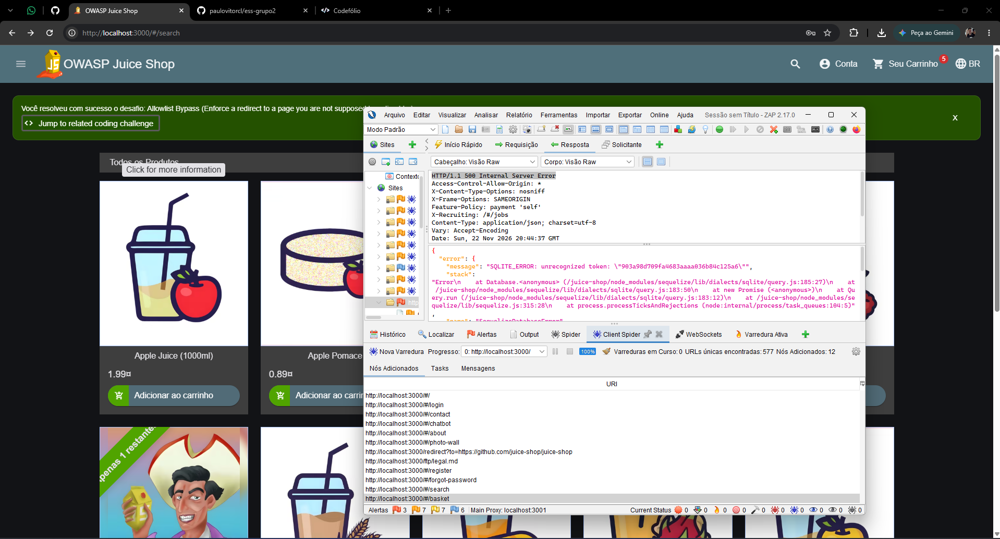
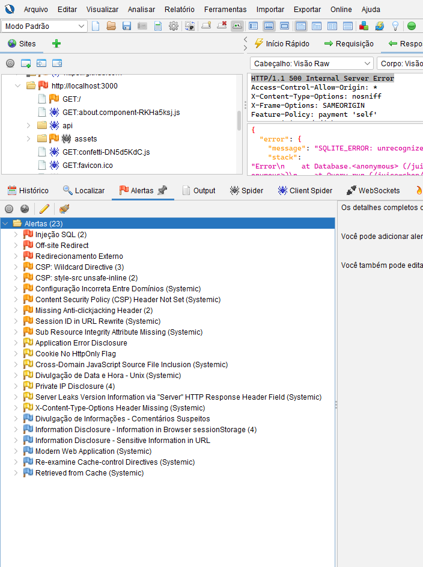

# Etapa 5 — Verificação de Vulnerabilidades

A verificação dinâmica de vulnerabilidades (DAST) busca observar o comportamento do sistema em tempo de execução, identificando falhas de configuração, ausência de cabeçalhos de segurança e brechas de injeção. Em conformidade com o escopo autorizado da disciplina, a varredura automatizada com o OWASP ZAP foi executada sobre o ambiente educacional controladamente vulnerável (OWASP Juice Shop), permitindo correlacionar os alertas observados aos ativos críticos, riscos priorizados e ameaças STRIDE modelados para o Sistema de Contabilidade. As evidências da execução, a tabela de análise dos achados e as respectivas propostas de mitigação seguem registradas detalhadamente a seguir.

## 1. Informações Gerais e Ambiente Testado
* **Sistema / Ambiente Testado:** OWASP Juice Shop (Aplicação web deliberadamente vulnerável executada localmente em container Docker no endereço `http://localhost:3000`).
* **Ferramenta Utilizada:** OWASP ZAP (Zed Attack Proxy) - Versão 2.17.0.
* **Escopo e Permissão:** Conforme estipulado no enunciado da disciplina, o teste foi realizado estritamente em ambiente educacional autorizado, utilizando uma aplicação vulnerável dedicada para testes de segurança.


## 2. Configuração Básica do Teste
A varredura foi conduzida por meio de uma sessão automatizada de *Automated Scan* combinando duas fases principais:
1. **Spider (Mapeamento Web):** Varredura dos endpoints e recursos da aplicação para mapear a árvore de navegação e as APIs HTTP/REST.
2. **Active Scan (Varredura Ativa DAST):** Envio de payloads de teste de injeção, manipulação de cabeçalhos e verificação de cookies de sessão contra os endpoints mapeados.


## 3. Evidências da Execução

### 3.1 Capturas de Tela do Ambiente de Execução

  
*Figura 1: Sessão de execução pelo OWASP ZAP usando http://localhost:3000.*

  
*Figura 2: Painel de alertas do OWASP ZAP com a listagem de vulnerabilidades identificadas.*


## 4. Tabela Consolidada de Análise de Vulnerabilidades

| ID | Alerta ou Achado | Evidência Textual (ZAP) | Possível Impacto no Sistema Contábil | Relação com OWASP / CWE / Projeto | Correção Proposta |
|---|---|---|---|---|---|
| **A01** | Injeção SQL (*SQL Injection*) | Erro HTTP 500 com mensagem do banco: `SQLITE_ERROR: near "(": syntax error` na consulta `SELECT * FROM Products...` | Comprometimento total da integridade e confidencialidade da base contábil (Ativo A14), permitindo alteração de lançamentos e vazamento de dados. | OWASP A03:2021 (Injection) / CWE-89 (Relacionado a T-03, T-06 e R10). | Adotar consultas parametrizadas (*Prepared Statements*) ou ORM com sanitização no backend em 100% das rotas de banco de dados. |
| **A02** | Cookie sem Flags de Segurança (`HttpOnly` / `Secure`) | Cabeçalhos de resposta HTTP contendo definição de cookies sem as proteções de sessão (`Set-Cookie: owasp-locale=en-US...`). | Sequestro de sessão (*Session Hijacking* - R04) e tomada de conta de contadores ou administradores (R01 / A01) via scripts XSS. | OWASP A07:2021 (Authentication Failures) / CWE-1004 e CWE-614 (Relacionado a S-04, VULN-03 e RS03). | Definir obrigatoriamente as flags `HttpOnly`, `Secure` e `SameSite=Strict` ou `Lax` na emissão de cookies pelo servidor de autenticação. |
| **A03** | Divulgação de Informações Sensíveis na URL (*Sensitive Info in URL*) | Requisição `GET /rest/user/security-question?email=foo-bar@example.com` expõe e-mails e parâmetros no caminho da URL. | Exposição de dados pessoais/LGPD (CPFs, salários, e-mails - Ativos A06, A07) em logs de servidor e histórico do navegador, facilitando IDOR (R18/R20). | OWASP A01:2021 (Broken Access Control) / CWE-598 (Relacionado a I-01, I-04, VULN-02 e RS02). | Transmitir dados sensíveis, filtros e tokens exclusivamente no corpo de requistições cifradas (`POST`/`PUT` via HTTPS em JSON). |


## 5. Detalhamento e Interpretação dos Achados

### Achado A01: Injeção SQL (*SQL Injection*)
* **Descrição:** A varredura do ZAP enviou um payload malicioso contendo caracteres de controle SQL no parâmetro de busca, provocando uma falha de sintaxe não tratada no banco de dados.
* **Trecho do Relatório / Evidência Textual:**
  ```http
  HTTP/1.1 500 Internal Server Error
  Content-Type: application/json; charset=utf-8

  {
    "error": {
      "message": "SQLITE_ERROR: near \"(\": syntax error",
      "code": "SQLITE_ERROR",
      "sql": "SELECT * FROM Products WHERE ((name LIKE '%'(%' OR description LIKE '%'(%') AND deletedAt IS NULL) ORDER BY name"
    }
  }
  ```
* **Contextualização com o Sistema Contábil (Etapas 1-3):** No projeto contábil, o **Banco de Dados (Ativo A14)** armazena lançamentos de débito/crédito, guias fiscais e dados bancários. Uma falha de Injeção SQL valida a ocorrência das ameaças **T-03** (Adulteração de Lançamentos) e **T-06** (Injeção via API) e do risco crítico **R10** (Estorno/Lançamento Fraudulento).
* **Proposta de Correção:** Substituir qualquer concatenação manual de strings SQL por **Prepared Statements** (consultas parametrizadas) no backend ou pela utilização de um ORM que sanitize os parâmetros de entrada.


### Achado A02: Cookie sem Flags de Segurança (`HttpOnly` e `Secure`)
* **Descrição:** A ferramenta identificou que cookies de controle de sessão ou localização estão sendo definidos no navegador sem os atributos protetores necessários contra roubo de token.
* **Trecho do Relatório / Evidência Textual:**
  ```http
  Set-Cookie: owasp-locale=en-US; Path=/; Expires=Mon, 22 Nov 2027 14:51:08 GMT; Max-Age=31536000; SameSite=lax
  ```
* **Contextualização com o Sistema Contábil (Etapas 1-3):** **Credenciais e Sessões (Ativo A01)** sustentam a identidade de contadores e clientes no sistema contábil. A ausência da flag `HttpOnly` permite que um script malicioso (XSS) acesse o cookie de sessão, concretizando a ameaça **S-04** (Reutilização de Sessão), o risco **R04** e a vulnerabilidade catalogada **VULN-03** / **RS03** (Proteção insuficiente contra tomada de conta).
* **Proposta de Correção:** Configurar o middleware do servidor HTTP para injetar as diretivas `HttpOnly` (impede leitura via JS), `Secure` (exige HTTPS) e `SameSite=Strict` em todos os cookies de autenticação.


### Achado A03: Divulgação de Informações Sensíveis na Query String da URL (*Information Disclosure*)
* **Descrição:** A ferramenta capturou requisições contendo dados de identificação do usuário diretamente nos parâmetros `GET` da URL.
* **Trecho do Relatório / Evidência Textual:**
  ```http
  GET http://localhost:3000/rest/user/security-question?email=foo-bar@example.com HTTP/1.1
  Host: localhost:3000
  User-Agent: Mozilla/5.0 ...
  ```
* **Contextualização com o Sistema Contábil (Etapas 1-3):** O sistema contábil lida com **Dados Cadastrais e Pessoais (Ativos A06 e A07)** protegidos pela LGPD. A transmissão de e-mails, CPFs ou tokens na URL expõe essas informações em logs de proxy, históricos de navegadores e cabeçalhos `Referer`, relacionando-se diretamente às ameaças **I-01**, **I-04** e aos riscos de bypass de autorização/IDOR (**R18**, **R20**, **VULN-02**).
* **Proposta de Correção:** Migrar a busca de recursos sensíveis para o corpo de requisições `POST` cifradas com payload JSON ou utilizar identificadores opacos/cifrados sem expor dados pessoais.


## 6. Análise de Limitações e Descarte de Falsos Positivos / Alertas Informativos

Como a execução do ZAP ocorreu de forma automatizada (DAST), foram gerados diversos alertas adicionais que foram analisados e classificados pelo grupo:

1. **Alertas Informativos e Recomendatórios Descartados:**
   - *Re-examine Cache-control Directives* e *Retrieved from Cache*: Classificados como informativos de navegação que não representam vulnerabilidades ativas imediatas na regra de negócio contábil.
   - *CSP (Content Security Policy) Notices*: Trata-se de recomendações sobre endurecimento de cabeçalhos de política de conteúdo, secundárias em relação aos riscos de injeção de dados diretos.

2. **Limitações do Teste Dinâmico Automatizado (DAST):**
   - O OWASP ZAP analisa a aplicação a partir de suas respostas de interface/API externas, sem visibilidade do código-fonte (caixa-preta).
   - O teste automatizado não consegue validar regras de negócio complexas mapeadas nas Etapas 1-3, como a **segregação de funções em pagamentos (quem cria não autoriza - VULN-01 / RS01)** ou a verificação de **limite de alçada**, que exigem testes de integração manuais ou automatizados específicos.
