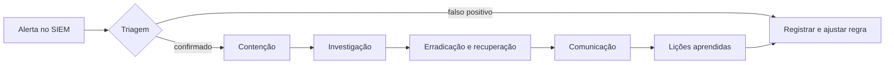

# Etapa 6 — Monitoramento e Detecção de Intrusões

Esta etapa detalha a função **Detect** do NIST CSF 2.0, já associada aos riscos
no [mapeamento da seção 2.9](../docs/etapa2/2.9-mapeamento-dos-riscos-para-as-funcoes-do-nist-csf-2-0.md).
A fonte de dados é a **Trilha de Auditoria (C5)**, que alimenta o componente
**Monitoramento / SIEM** previsto no
[diagrama da arquitetura segura](../docs/etapa3/3.3-diagrama-arquitetura-segura.md).
As regras de detecção cobrem os riscos prioritários da
[seção 2.6](../docs/etapa2/2.6-priorizacao-dos-riscos.md) e complementam os
requisitos de segurança RS01, RS02 e RS03 da
[seção 3.1](../docs/etapa3/3.1-requisitos-de-seguranca.md).

## 6.1 O que é detecção de intrusões

**Detecção de intrusões** é a identificação de tentativas, ou de acessos
efetivos, que violam a política de segurança do sistema. Ela é feita pela
análise contínua de eventos registrados, como logs de autenticação,
autorização, operações de negócio e tráfego. O objetivo é perceber o ataque a
tempo de conter o dano e de preservar as evidências para a investigação.

Há dois níveis de observação:

| Nível | O que observa | Exemplo |
| --- | --- | --- |
| Rede (NIDS) | Pacotes e conexões | Varredura de portas, assinatura de exploit conhecido |
| Aplicação | Ações de usuários e serviços dentro do sistema | Login após várias falhas, acesso a dados de outra empresa, pagamento após troca de conta bancária |

Neste sistema contábil, o foco é a **detecção na aplicação**. Os riscos mais
graves, como fraude de pagamento (R13), desvio por troca de dados bancários
(R09) e quebra de isolamento entre empresas (R18), acontecem por requisições
HTTPS válidas, feitas muitas vezes com uma credencial legítima comprometida.
Um IDS de rede não distingue esse tráfego do uso normal. Só os eventos de
negócio registrados pela aplicação revelam o abuso.

As regras usam duas técnicas complementares:

- **Por assinatura (regra):** reconhece um padrão conhecido de ataque. Exemplo:
  o mesmo código TOTP é apresentado duas vezes (R02).
- **Por anomalia (comportamento):** compara o evento com o comportamento usual
  do usuário ou do tenant. Exemplo: um pagamento acima de três vezes a média
  histórica do beneficiário (R13).

## 6.2 Diferença entre prevenir e detectar

| Aspecto | Prevenir | Detectar |
| --- | --- | --- |
| Objetivo | Impedir que o evento indesejado ocorra | Perceber que o evento ocorreu ou está em andamento |
| Momento | Antes ou durante a requisição | Durante ou depois, pela análise dos eventos |
| Função NIST CSF | Protect | Detect |
| Exemplo — autenticação | C2: bloqueio da conta após 5 tentativas em 15 minutos (RS03) | Alerta quando um mesmo IP falha em muitas contas diferentes (credential stuffing) |
| Exemplo — autorização | C3: `HTTP 403` quando o usuário não tem vínculo com o tenant (RS02) | Alerta quando um usuário acumula respostas 403 de tenants diferentes |
| Exemplo — pagamentos | C4: criador ≠ aprovador e comparação de hash (RS01) | Alerta de pagamento logo após a alteração da conta bancária do beneficiário |
| Limitação | Não reconhece um usuário legítimo com credencial comprometida | Depende de logs completos e íntegros (R14, R16) e gera falsos positivos |

As duas camadas são complementares (**defesa em profundidade**). O controle
preventivo de RS03 limita as tentativas **por conta**, mas não impede que um
atacante teste uma única senha vazada em milhares de contas diferentes. Cada
conta fica abaixo do limite, e só a correlação feita pela detecção revela o
ataque. Da mesma forma, a segregação de funções de RS01 não impede que dois
usuários legítimos, um deles enganado, aprovem um pagamento para uma conta
recém-alterada. Prevenir reduz a probabilidade; detectar reduz o tempo de
exposição e, portanto, o impacto.

## 6.3 Eventos do sistema que devem ser registrados

| Categoria | Evento | Componente de origem | Riscos relacionados |
| --- | --- | --- | --- |
| Autenticação | Login com sucesso e com falha (motivo genérico para o usuário, motivo detalhado no log) | Serviço de Autenticação | R01, R17 |
| Autenticação | Código MFA inválido, expirado ou reutilizado | Serviço de Autenticação | R01, R02 |
| Autenticação | Bloqueio temporário de conta e desbloqueio | Serviço de Autenticação | R01, R23 |
| Autenticação | Solicitação e conclusão de redefinição de senha; alteração de e-mail ou telefone | Serviço de Autenticação | R03 |
| Sessão | Criação, renovação, logout, expiração e revogação de sessão | Serviço de Autenticação | R04 |
| Autorização | Requisição negada (`HTTP 403`) por perfil ou por tenant, com o recurso solicitado | Autorização no servidor | R08, R18, R20 |
| Administração | Alteração de perfil, permissão ou vínculo usuário–tenant | Aplicação Web / API | R08 |
| Cadastro | Inclusão ou alteração de dados bancários de beneficiário | Núcleo — Cadastro | R09 |
| Pagamentos | Criação, aprovação, reautenticação, execução e cancelamento de pagamento | Núcleo — Pagamentos | R13, R26 |
| Pagamentos | Divergência entre o hash dos dados aprovados e o dos dados executados | Núcleo — Pagamentos | R13 |
| Contábil e fiscal | Estorno, alteração de lançamento em período fechado, geração e transmissão de SPED | Núcleo — Escrituração/Fiscal | R10, R11, R15 |
| Documentos | Download ou exportação, com quantidade de itens e volume | Núcleo — Documentos | R19, R24 |
| Segredos | Leitura de certificado ou chave no cofre de segredos | Cofre de Segredos | R06 |
| Integrações | Falha de validação TLS/mTLS, erro e timeout com serviço externo | Camada de Integração | R05, R07, R25 |
| Auditoria | Tentativa de alteração ou exclusão de registros da trilha | Trilha de Auditoria | R14 |

**Campos mínimos de cada evento** (controle C5): data e hora em UTC, `user_id`,
`tenant_id`, perfil, endereço IP, identificador de sessão e dispositivo, ação,
recurso afetado, resultado (sucesso, falha ou negado), estado antes e depois
(quando houver alteração) e `correlation_id` para ligar os eventos de uma mesma
operação.

**O que não deve ser registrado** (R21): senhas, códigos TOTP, tokens de sessão
ou de API, conteúdo de certificados e números completos de CPF ou de conta
bancária. Esses campos são omitidos ou mascarados (por exemplo,
`***.456.789-**`).

**Proteção dos próprios logs** (R14, R16): gravação append-only/WORM, relógios
sincronizados por NTP, retenção mínima definida pela política do escritório e
acesso de leitura restrito ao perfil de auditor, limitado aos tenants sob sua
responsabilidade.

## 6.4 Regras de detecção

### DET-01 — Credential stuffing e força bruta no login

| Item | Descrição |
| --- | --- |
| Risco observado | **R01** — acesso à conta com credenciais vazadas (com R17 e R02) |
| Requisito / controle | RS03 · C1, C2 |
| Fonte de dados | Eventos de autenticação do Serviço de Autenticação e logs do Gateway de API |
| Condição de alerta | (a) um mesmo IP com mais de **20 falhas de login em pelo menos 10 contas distintas em 5 minutos**; **ou** (b) **login bem-sucedido** em uma conta que teve **5 ou mais falhas** nos 15 minutos anteriores; **ou** (c) **reuso de um código TOTP** já consumido |
| Severidade | Alta (a); Crítica (b) e (c) |
| Resposta inicial | Bloquear o IP ou exigir desafio adicional no gateway; em (b) e (c), revogar imediatamente a sessão criada, forçar a troca de senha e avisar o titular por canal já confirmado |

### DET-02 — Tentativa de acesso a dados de outra empresa

| Item | Descrição |
| --- | --- |
| Risco observado | **R18** — quebra de isolamento entre empresas (com R20 e R08) |
| Requisito / controle | RS02 · C3 |
| Fonte de dados | Eventos de autorização negada (`HTTP 403`) por ausência de vínculo com o tenant |
| Condição de alerta | (a) um mesmo usuário com **5 ou mais negações por tenant em 10 minutos**; **ou** (b) requisições com **identificadores de recurso sequenciais** (enumeração); **ou** (c) **qualquer** negação por tenant gerada por um perfil administrativo |
| Severidade | Alta (a) e (b); Crítica (c) |
| Resposta inicial | Suspender a sessão do usuário, revisar os acessos **bem-sucedidos** dele no mesmo período para confirmar se houve exposição e, se houver, tratar como incidente de dados pessoais |

### DET-03 — Pagamento anômalo após troca de dados bancários

| Item | Descrição |
| --- | --- |
| Risco observado | **R13** — pagamento não autorizado ou adulterado (com R09 e R26) |
| Requisito / controle | RS01 · C4 |
| Fonte de dados | Eventos de cadastro (alteração de dados bancários) e de pagamentos |
| Condição de alerta | (a) pagamento aprovado para um beneficiário cuja **conta bancária foi alterada nas últimas 24 horas**; **ou** (b) **divergência entre o hash aprovado e o executado**; **ou** (c) valor **acima de 3 vezes a média** dos últimos pagamentos ao beneficiário; **ou** (d) duas execuções com a mesma `Idempotency-Key` |
| Severidade | Crítica |
| Resposta inicial | **Reter o pagamento** antes do envio ao banco, confirmar a alteração com o titular por outro canal (telefone já cadastrado), congelar o cadastro bancário do beneficiário e acionar o responsável financeiro do tenant |

### Resumo

| Regra | Risco principal | Requisito | Severidade máxima | Tipo |
| --- | --- | --- | --- | --- |
| DET-01 | R01 | RS03 | Crítica | Assinatura + limiar |
| DET-02 | R18 | RS02 | Crítica | Limiar + padrão |
| DET-03 | R13 | RS01 | Crítica | Correlação + anomalia |

Os limiares (20 falhas, 5 negações, 24 horas, 3 vezes a média) são valores
iniciais. Eles devem ser calibrados com dados reais de uso para equilibrar
falsos positivos e falsos negativos.

## 6.5 Procedimento após um alerta

1. **Triagem:** o analista confirma se o alerta é legítimo, comparando-o com o
   histórico do usuário e do tenant, e classifica a severidade. Falsos
   positivos são registrados para calibrar a regra.
2. **Contenção:** limita o dano imediatamente. Revogar a sessão ou a
   credencial, bloquear o IP, suspender a conta, reter o pagamento ou desativar
   a chave de integração, conforme a regra disparada.
3. **Investigação:** reúne todos os eventos ligados ao alerta pelo
   `correlation_id`, pelo usuário e pelo IP, e determina o alcance: quais
   tenants, dados e operações foram afetados e desde quando.
4. **Erradicação e recuperação:** remove a causa (troca de senhas, rotação de
   certificados e chaves no cofre, correção da falha explorada) e restaura o
   estado correto, por exemplo revertendo uma alteração cadastral, solicitando
   o estorno ao banco ou retificando uma obrigação fiscal.
5. **Comunicação:** informa o cliente afetado e os titulares dos dados. Se
   houver dados pessoais envolvidos com risco ou dano relevante, avalia a
   comunicação à ANPD e aos titulares, conforme o art. 48 da LGPD.
6. **Lições aprendidas:** documenta o incidente, ajusta os limiares das regras
   e atualiza o [registro de riscos](../docs/etapa2/2.4-registro-de-riscos.md)
   e o [plano de tratamento](../docs/etapa2/2.10-plano-de-tratamento-dos-riscos.md).

### Prazos por severidade

| Severidade | Exemplos | Início da triagem | Contenção | Responsável |
| --- | --- | --- | --- | --- |
| Crítica | DET-01 (b, c), DET-02 (c), DET-03 | Imediato | Até 15 minutos | Equipe de segurança + responsável financeiro do tenant |
| Alta | DET-01 (a), DET-02 (a, b) | Até 15 minutos | Até 1 hora | Equipe de segurança |
| Média | Falhas isoladas de integração, bloqueios de conta pontuais | Até 4 horas | Até 1 dia útil | Suporte / operação |

Todo o procedimento também é registrado na trilha de auditoria. Assim, as
ações de resposta ficam rastreáveis e não podem ser repudiadas (R15).
